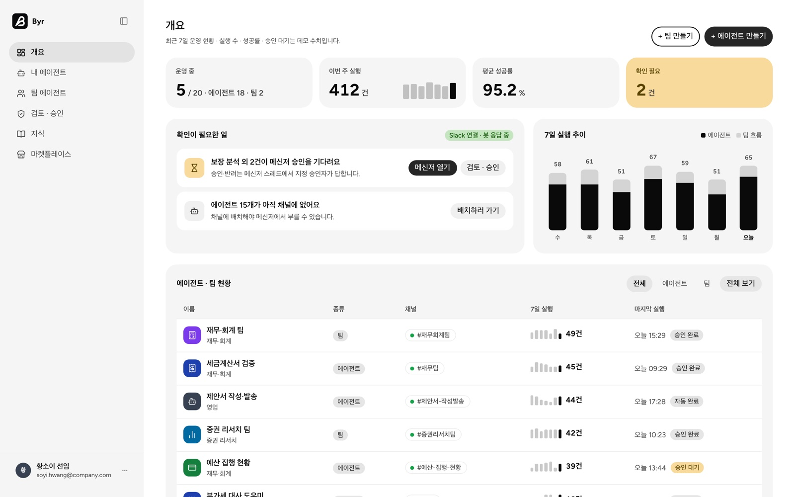

# Byr

직접 설정한 AI 에이전트로 메신저에서 반복 업무를 처리하는 서비스의 프로토타입입니다.
직무별 템플릿으로 에이전트를 만들고, Slack에서 요청 · 수정 · 승인을 대화로 처리합니다. 팀 협업과 정기 실행은 웹 콘솔에서 관리합니다.

- 운영 콘솔: https://byr-console.vercel.app/demo (로그인 없이 데모 계정으로 열림)
- 브랜드 사이트: https://byr-web.vercel.app



> 외주 프로젝트(NDA)를 가명 브랜드로 다시 구현한 데모입니다. 고객사 코드와 데이터는 포함하지 않습니다.

## 주요 기능

- **에이전트 생성** — 직무 8개 · 업무 템플릿 45개에서 시작하고, 업무를 고르면 필요한 스킬이 미리 켜집니다.
- **메신저 응답** — Slack @멘션으로 요청하면 진행 상태 → 결과 요약 → 근거 → 다음 행동 → 원본 PDF 순서로 답합니다. 수정본은 바뀐 점부터 보여줍니다.
- **승인** — 지정 승인자가 스레드에서 '승인' 또는 '반려: 사유'로 답해야 실행됩니다. 요청자와 처리자를 이력에 남기고, 한 건은 한 번만 실행됩니다.
- **팀 에이전트** — 여러 에이전트를 스텝으로 묶고 순서 · 승인 게이트 · 정기 실행 스케줄을 설정합니다.
- **채널 배치** — 콘솔에서 에이전트를 채널에 배치 · 해제하면 Slack 채널에 알림이 가고, 해제한 채널은 보관 후 되돌릴 수 있습니다.

## 기술 스택

| 영역 | 사용 기술 | 배포 |
|---|---|---|
| 운영 콘솔 | React · Vite · TypeScript | Vercel |
| 백엔드 · Slack 봇 | FastAPI · Slack Bolt | Render (`render.yaml`) |
| 브랜드 사이트 | HTML · CSS · JS | Vercel |

## 폴더 구조

```
web/                 브랜드 사이트
console/frontend/    운영 콘솔
console/backend/     API · Slack 봇
docs/images/         README 이미지
```

## 로컬 실행

```bash
cd console
./dev.sh        # 백엔드 http://localhost:8000 · 콘솔 http://localhost:5173
```

### 환경 변수 (선택)

| 변수 | 용도 |
|---|---|
| `BYR_SLACK_BOT_TOKEN` · `BYR_SLACK_APP_TOKEN` | Slack 봇 연결 (둘 다 있을 때만 켜짐) |
| `BYR_ADMIN_EMAIL` · `BYR_ADMIN_SALT` · `BYR_ADMIN_HASH` | 이메일 로그인 (없으면 `/demo`로만 접속) |
| `VITE_UNSPLASH_ACCESS_KEY` | 콘솔 이미지 검색 (`console/frontend/.env.example` 참고) |

## 테스트

```bash
cd console/backend
uv run python -m tests.test_messenger_router
uv run python -m tests.test_team_router
uv run python -m tests.test_team_phase2
```

백엔드 테스트 74개 (메신저 라우터 16 · 팀 라우터 24 · 팀 2단계 34)

## 만든 사람

황소이 · Product Designer — sso2.design@gmail.com
